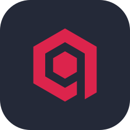
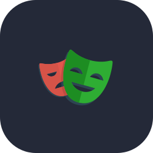
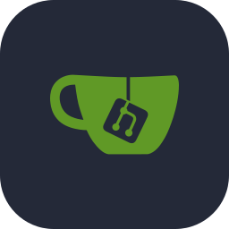

<p align="center">
  
</p>

<p align="center">
  <picture>
    <source media="(prefers-color-scheme: dark)" srcset="https://readme-typing-svg.demolab.com?font=JetBrains+Mono&weight=500&size=20&duration=3200&pause=900&color=F3E4DF&center=true&vCenter=true&width=620&height=40&lines=Desenvolvedor+Full+Stack;Do+front-end+ao+back-end;Testes+E2E+e+automa%C3%A7%C3%A3o;IA+aplicada+no+dia+a+dia">
    
  </picture>
</p>

<br>

## Sobre mim

Sou desenvolvedor full stack na **InterTV**, afiliada da Globo no interior do Rio. Trabalho de ponta a ponta: interfaces em React e TypeScript, APIs em Python e Django, e a infraestrutura que mantém tudo de pé.

No trabalho, desenvolvo o **IRIS**, uma plataforma interna que usa IA para ajudar a redação a acompanhar o que acontece na região.

Fora dele, gosto de construir ferramentas que resolvem problemas reais, meus e de quem está perto: um assistente de desenvolvimento por voz, um app de contas da casa, a loja virtual da minha mãe e um treinador de xadrez para estudar com meu irmão. E testo tudo. Se dá para automatizar, eu automatizo.

```text
base      São Pedro da Aldeia, RJ
trabalho  InterTV · tecnologia
stack     React · TypeScript · Python · Django
gosto     testes E2E · automação · IA local
```

<br>

## Tecnologias

<table align="center">
  <tr>
    <td align="right" width="130"><sub><b>FRONTEND</b></sub></td>
    <td align="center" width="80"><br><sub>React</sub></td>
    <td align="center" width="80"><br><sub>TypeScript</sub></td>
    <td align="center" width="80"><br><sub>JavaScript</sub></td>
    <td align="center" width="80"><br><sub>Next.js</sub></td>
    <td align="center" width="80"><br><sub>HTML</sub></td>
    <td align="center" width="80"><br><sub>CSS</sub></td>
    <td align="center" width="80"><br><sub>Tailwind</sub></td>
    <td align="center" width="80"><br><sub>Bootstrap</sub></td>
    <td align="center" width="80"><br><sub>Vite</sub></td>
  </tr>
  <tr>
    <td align="right"><sub><b>BACKEND</b></sub></td>
    <td align="center"><br><sub>Python</sub></td>
    <td align="center"><br><sub>Django</sub></td>
    <td align="center"><br><sub>FastAPI</sub></td>
    <td align="center"><br><sub>Node.js</sub></td>
    <td align="center"><br><sub>Celery</sub></td>
    <td align="center"><br><sub>Telegram Bot</sub></td>
    <td colspan="3"></td>
  </tr>
  <tr>
    <td align="right"><sub><b>MOBILE</b></sub></td>
    <td align="center"><br><sub>React Native</sub></td>
    <td align="center"><br><sub>Expo Go</sub></td>
    <td align="center"><br><sub>Android Studio</sub></td>
    <td colspan="6"></td>
  </tr>
  <tr>
    <td align="right"><sub><b>DADOS</b></sub></td>
    <td align="center"><br><sub>PostgreSQL</sub></td>
    <td align="center"><br><sub>Redis</sub></td>
    <td align="center"><br><sub>Supabase</sub></td>
    <td align="center"><br><sub>Qdrant</sub></td>
    <td colspan="5"></td>
  </tr>
  <tr>
    <td align="right"><sub><b>IA</b></sub></td>
    <td align="center"><br><sub>Ollama</sub></td>
    <td align="center"><br><sub>Gemini</sub></td>
    <td align="center"><br><sub>MCP</sub></td>
    <td colspan="6"></td>
  </tr>
  <tr>
      <td align="right"><sub><b>TESTES</b></sub></td>
      <td align="center"><br><sub>Selenium</sub></td>
      <td align="center"><br><sub>Postman</sub></td>
      <td align="center"><br><sub>Jest</sub></td>
      <td align="center"><br><sub>Playwright</sub></td>
      <td align="center"><br><sub>PyAutoGUI</sub></td>
      <td colspan="4"></td>
    </tr>
  <tr>
      <td align="right"><sub><b>INFRA</b></sub></td>
      <td align="center"><br><sub>Docker</sub></td>
      <td align="center"><br><sub>Linux</sub></td>
      <td align="center"><br><sub>Ubuntu</sub></td>
      <td align="center"><br><sub>Nginx</sub></td>
      <td align="center"><br><sub>Prometheus</sub></td>
      <td align="center"><br><sub>Grafana</sub></td>
      <td align="center"><br><sub>Cloudflare</sub></td>
      <td align="center"><br><sub>PowerShell</sub></td>
      <td></td>
    </tr>
  <tr>
      <td align="right"><sub><b>GESTÃO</b></sub></td>
      <td align="center"><br><sub>Git</sub></td>
      <td align="center"><br><sub>Gitea</sub></td>
      <td align="center"><br><sub>Jira</sub></td>
      <td colspan="6"></td>
    </tr>
</table>

<p align="center">
  
  
  
  
  
  
  <br>
  
  
</p>

<br>

## Projetos

<table>
  <tr>
    <td colspan="2" valign="top">
      
      <h3>IRIS</h3>
      <p>Plataforma interna de monitoramento e curadoria de notícias com IA, usada pela redação no dia a dia. Atuo no desenvolvimento full stack da aplicação.</p>
      <p>
        
        
        
        
        
      </p>
    </td>
  </tr>
  <tr>
    <td width="50%" valign="top">
      
      <h3><a href="https://github.com/Yurilxm/Jarvis.git">Jarvis</a></h3>
      <p>Assistente de desenvolvimento por linha de comando. Faz commits inteligentes, cuida de branches e pull requests, revisa código com IA e gera documentação. Também tem OCR híbrido e ativação por voz com wake word local.</p>
      <p>
        
        
        
        
        
      </p>
    </td>
    <td width="50%" valign="top">
      
      <h3><a href="https://github.com/Yurilxm/scanner-inteligente.git">Control</a></h3>
      <p>App de contas da casa. Lê contas de consumo, boletos e comprovantes Pix com OCR no próprio aparelho, organiza os vencimentos, avisa antes de vencer e exporta para Excel. Também aceita contas sem comprovante, como academia e curso, com acesso protegido por biometria ou PIN.</p>
      <p>
        
        
        
      </p>
    </td>
  </tr>
  <tr>
    <td width="50%" valign="top">
      
      <h3><a href="https://github.com/Yurilxm/Nick_site.git">Loja virtual</a></h3>
      <p>E-commerce feito para a loja da minha mãe: catálogo de produtos, carrinho, login de clientes e compra segura, com pagamento e frete integrados via webhooks.</p>
      <p>
        
        
        
      </p>
    </td>
    <td width="50%" valign="top">
      
      <h3><a href="https://github.com/Yurilxm/Chess-coach.git">Treinador de xadrez</a></h3>
      <p>Academia de xadrez interativa, feita para estudar com meu irmão. Tem partidas contra bot com nível ajustável, modo editor, análise das melhores jogadas com explicações e puzzles reais do Lichess.</p>
      <p>
        
        
        
      </p>
    </td>
  </tr>
</table>

<br>

## No GitHub

<p align="center">
  
  &nbsp;
  
</p>

<p align="center">
  
</p>

<!--
  Gráfico de atividade: o serviço público está fora do ar.
  Para ativar, hospede sua própria instância de github.com/Ashutosh00710/github-readme-activity-graph
  na Vercel, troque SEU-DOMINIO abaixo e remova as marcações de comentário.

<p align="center">
  
</p>
-->

<p align="center">
  
</p>

<p align="center">
  <picture>
    <source media="(prefers-color-scheme: dark)" srcset="https://raw.githubusercontent.com/YuriLXM/YuriLXM/output/snake-dark.svg">
    
  </picture>
</p>

<br>

## Onde me encontrar

<p align="center">
  <a href="https://www.linkedin.com/in/yurixavier14/"></a>
  <a href="https://www.instagram.com/yurixavier14/"></a>
</p>

<br>

<p align="center">
  
</p>

<p align="center">
  <sub><b>YURI LIMA</b> · São Pedro da Aldeia, RJ</sub>
  <br>
  <sub>todos os testes passaram · obrigado pela visita</sub>
</p>
